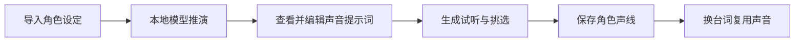

# TimbreForge · 角色声线工作室

用自然语言设计原创角色的声音：导入人物设定，查看模型推演的声线提示词，生成试听，并保存喜欢的声音用于后续台词。

Chinese-first local voice studio: turn character profiles into editable voice prompts, generate previews, and reuse saved reference voices with new dialogue.

**当前版本：0.5.0a1 · Alpha**。语言模型与语音模型需另行配置；本仓库仅包含源码、文档、测试和版本清单。

## 功能

| 功能 | 使用方式 |
| --- | --- |
| 角色设定 → 声线推演 | 粘贴设定，或导入 Word `.docx`、TXT、Markdown、JSON；本地语言模型给出声音特征、依据、待确认项、完整提示词和试听台词。 |
| 一句话生成 | 只输入声音描述，自动选择设备、模型采样配置和随机种子。 |
| 试听、重生成与声线库 | 修改提示词、换种子、切换最近 3 条试听记录；保存到新角色或给已有角色追加声线。 |
| 参考克隆与角色复用 | 默认使用 Qwen Base 0.6B，以固定参考音频和准确转录生成新台词。 |
| 进阶设计与多角色创作 | 手动采样参数、候选 A/B、收藏备注、脚本逐句生成、人工选择后导出分轨与混合轨。 |
| 资源管理 | 重模型串行执行，释放闲置 ComfyUI/IndexTTS 缓存；长台词克隆分段生成，Qwen 内存错误清理后重试一次。 |



## 快速开始

### 1. 安装工作室

需要 **Python 3.11 或 3.12**。以下以 Windows PowerShell 为例：

```powershell
git clone https://github.com/zdd3143/timbreforge.git
cd timbreforge
python -m venv .venv
.venv\Scripts\Activate.ps1
python -m pip install ".[ui]"
Copy-Item timbreforge.example.toml timbreforge.local.toml
```

Linux 可用 `source .venv/bin/activate` 激活环境，再复制示例配置。Windows 是当前真实模型验收环境；其他平台仍需验证对应 CUDA 与模型运行环境。

### 2. 配置独立模型环境

编辑 `timbreforge.local.toml`，填写模型 Python 和**完整模型快照**路径。工作室环境与模型环境分开，不要把模型权重放进 Git 仓库。

| 用途 | 模型 | 对应配置 |
| --- | --- | --- |
| 角色设定推演 | `Qwen/Qwen3-1.7B` | `[planner] python / model` |
| 描述生成声音 | `Qwen/Qwen3-TTS-12Hz-1.7B-VoiceDesign` | `[qwen] python / design_model` |
| 克隆、保存角色后换台词 | `Qwen/Qwen3-TTS-12Hz-0.6B-Base` | `[qwen] python / base_model` |

角色推演是可选功能；只用一句话生成时不需要语言模型。IndexTTS/ComfyUI、CosyVoice3 和评分器也是可选后端。

模型版本和已验收运行环境见 [VoiceDesign 配置](docs/VOICE_DESIGN.md)、[角色推演配置](docs/ROLE_PLANNER.md)及 [后端说明](docs/BACKENDS.md)。语音模型基线为 `qwen-tts==0.1.1`；实际 PyTorch/CUDA 需按机器单独安装并验证。软件启动不会自动下载模型。

### 3. 启动

```powershell
python -m timbreforge.launcher --check
python -m timbreforge.launcher
```

也可以在已安装依赖的环境中双击 `启动声线工作室.cmd`。默认打开 [本地工作室](http://127.0.0.1:7860)。端口被占用时可使用 `--port 7862`；`--no-browser` 只启动服务。

首次使用可从「简化版 · 一句话生成」开始；已有角色资料时，使用「角色设定 → 声线推演」。推演与成功生成的试听会保存到本机，重新打开后可刷新记录并恢复。[完整上手指南](docs/QUICKSTART.md)

## 克隆与内存

在「参考克隆 / 表演指令」上传 **30 秒以内**的参考音频，填写准确完整转录和新台词，使用默认 Qwen Base 后端生成。Qwen Base 的表演指令应留空；IndexTTS 与 CosyVoice 的指令能力和参数语义不同。

工作室按需启动独立模型进程，结束后退出。同一输出目录下的工作室与命令行共用资源锁；调用前释放本机闲置 ComfyUI/IndexTTS 模型缓存。不会强制关闭其它应用或中断已有任务。长台词分段可能影响语气衔接，需要试听确认。[内存策略与故障排查](docs/MEMORY_MANAGEMENT.md)

已在 RTX 4060 Laptop 8 GB 上验证本地角色推演、VoiceDesign、Qwen Base 克隆及浏览器生成。一次两段克隆输出 25.36 秒音频，PyTorch 峰值显存约 2.60 GiB，结束后整卡显存回到运行前水平。这是单次实测，**不是最低配置或音质保证**。[本机验收记录](docs/LOCAL_ACCEPTANCE_2026-10-16.md)

## 数据与使用边界

- 按示例配置，输出保存在 `.local-data/outputs/`，角色与声线库保存在 `.local-data/characters/`。备份时应同时保留音频和元数据。
- `.gitignore` 排除本机配置、录音、模型、缓存和生成结果；仓库和安装包不分发这些资产。
- 声线推演是创作建议。声音贴合度、文字准确性和身份一致性需要试听确认；保存角色不是训练或微调模型。
- 使用参考声音前应确认使用权和说话者授权，不用于冒充、欺诈或侵权。界面面向本机可信用户，不提供公网多用户鉴权。[声音权利与安全](docs/SAFETY.md)

## 命令行与开发

仅安装 CPU 核心可使用 `python -m pip install .`；核心依赖为 NumPy 和 SoundFile，界面为可选 Gradio extra。

```powershell
python -m timbreforge capabilities
python -m timbreforge --config timbreforge.local.toml generate --backend qwen3 --task clone --reference authorized-reference.wav --ref-text "参考音频实际说出的完整内容。" --text "新的台词。" --confirm-rights
python -m unittest discover -s tests -p "test_*.py" -v
python tools/release_check.py
python tools/backend_audit.py
```

`authorized-reference.wav` 是占位路径。测试使用临时合成采样和模拟后端；真实模型推理不纳入核心 CI。仓库提供 Windows/Linux、Python 3.11/3.12 的 CI 矩阵，结果以实际工作流为准。

另保留独立实验合成器 `timbreforge-synth` 和旧数据集检索 `timbreforge-voicegen`。实验合成器生成程序化音色，并非自然语音 TTS；它们不属于角色声线主流程。

## 文档与反馈

- [配置说明](docs/CONFIGURATION.md) · [使用指南](docs/USAGE.md) · [多角色创作](docs/CREATION.md)
- [角色推演与导入](docs/ROLE_PLANNER.md) · [声音设计](docs/VOICE_DESIGN.md) · [参考音频助手](docs/REFERENCE_ASSISTANT.md)
- [公开角色示例](examples/public-role-profile.md) · [AutoDL 部署](docs/AUTODL.md)
- [测试说明](docs/TESTING.md) · [发布检查](docs/RELEASING.md) · [更新记录](CHANGELOG.md)
- [贡献指南](CONTRIBUTING.md) · [安全报告](SECURITY.md)

缺陷报告请附复现步骤、版本、系统和脱敏错误信息；不要上传私人录音、密钥或本机配置。

## 许可

原创项目代码采用 [Apache-2.0](LICENSE)。模型、第三方库、数据、录音及声音权利分别适用各自条款，见 [第三方说明](THIRD_PARTY_NOTICES.md)。
